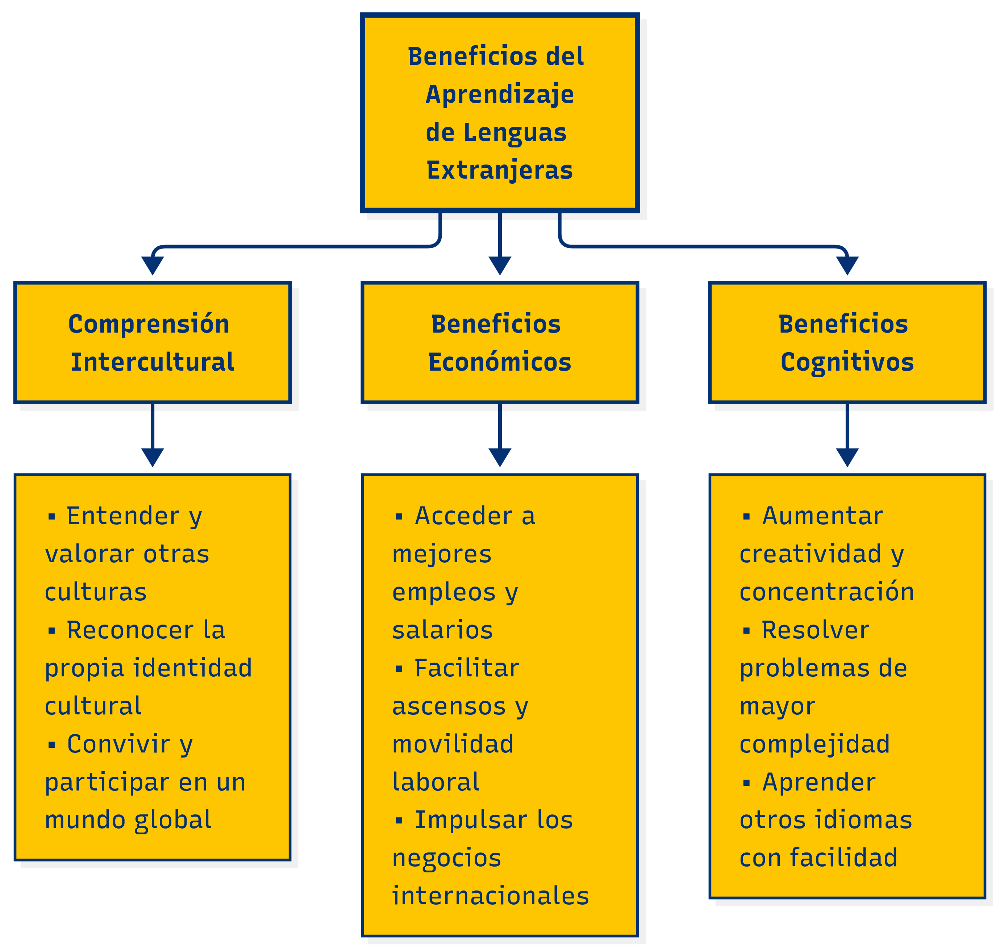
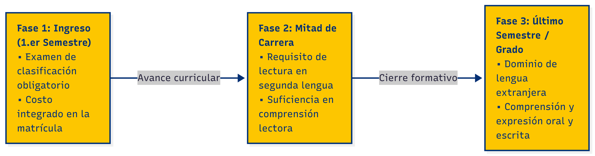

::: {.callout-warning}
### Aviso preliminar
El presente reporte constituye un ejercicio analítico preliminar y no representa un documento oficial ni una versión definitiva.
:::

```{r}
#| label: cargar-paquetes
#| message: false
library(tidyverse)
library(knitr)
```

```{=html}
<style>
  p { 
    text-align: justify;
  }
</style>
```

# Introducción

Este informe analiza el desempeño de los estudiantes de pregrado de la Universidad Militar Nueva Granada (UMNG) en el módulo de inglés de las pruebas Saber Pro (2021-2024), examinando la evolución de sus puntajes y niveles de desempeño.

A partir de este diagnóstico, se plantea una ruta de mejoramiento estructurada en 3 fases formativas desde el ingreso hasta la graduación para fortalecer de manera continua las competencias en una segunda lengua.

# Marco de Evaluación de la Competencia

De acuerdo con la guía de orientación del examen Saber Pro [@icfes_guiorientacion_2024, p. 57], el módulo de inglés evalúa la competencia para comunicarse efectivamente en lengua inglesa mediante tareas de lectura y uso de la lengua. Alineado con las directrices del Marco Común Europeo de Referencia (MCER), clasifica el desempeño de los evaluados en 4 niveles: A1, A2, B1 y B2. El instrumento está integrado por 7 partes, cada una orientada a una habilidad específica y con una ponderación porcentual definida: Parte 1 (11%), Parte 2 (11%), Parte 3 (11%), Parte 4 (18%), Parte 5 (16%), Parte 6 (11%) y Parte 7 (22%) [@icfes_guiorientacion_2024, p. 57].

# Beneficios del Aprendizaje de Lenguas Extranjeras

El aprendizaje de una segunda lengua trasciende la adquisición de destrezas comunicativas básicas, constituyéndose en un habilitador integral del desarrollo humano, académico y laboral. De acuerdo con el marco de evaluación de lenguas extranjeras de PISA [@oecd_pisa_2021, pp. 10-11], los beneficios derivados de esta competencia se agrupan en 3 dimensiones (ver @fig-beneficios):

1. **Comprensión intercultural:** Promueve la conciencia y el aprecio de la diversidad cultural, profundiza en la complejidad de los valores sociales y permite resignificar la propia identidad a través del contraste con otras perspectivas globales, favoreciendo una ciudadanía democrática y activa.
2. **Beneficios económicos:** Confiere ventajas competitivas tangibles en el mercado de trabajo mediante mayor empleabilidad, oportunidades de ascenso y primas salariales positivas. En el plano macroeconómico, estimula el comercio exterior, la inversión extranjera directa y la transferencia tecnológica transfronteriza.
3. **Beneficios cognitivos:** Desarrolla el pensamiento creativo, la flexibilidad cognitiva y la resolución de problemas de alta complejidad. Asimismo, potencia la atención mental sostenida, afianza la comprensión metalingüística y genera efectos facilitadores sobre la lectoescritura en la lengua materna.

{#fig-beneficios fig-align="center" width="60%"}

# Resultados Saber Pro UMNG (2021-2024)

```{r}
#| label: importar-seleccionar
saber_pro_ingles_2021_2024_umng <- read_rds(
  file = "../data/2021-2024_saber-pro-genericas_umng.rds"
) |>
  select(
    ano,
    estu_consecutivo,
    mod_ingles_desem,
    mod_ingles_punt
  )
```

En la @fig-distribucion se presenta la distribución anual de los puntajes individuales ($x_i \in [0, 300]$) obtenidos por los estudiantes de la UMNG, desagregada según el nivel de desempeño alcanzado en el módulo.

```{r}
#| label: fig-distribucion
#| fig-cap: "Distribución del puntaje en el módulo de inglés en la UMNG desagregado por nivel de desempeño (2021-2024)."
#| fig-height: 7
#| warning: false
## Paleta primaria UMNG ----
paleta_primaria_umng <- c(
  "#043074",
  "#fdc600",
  "#0d5e30",
  "#ee2a24",
  "#000000",
  "#ffffff"
)

## Histograma ---
saber_pro_ingles_2021_2024_umng |>
  ggplot(
    mapping = aes(x = mod_ingles_punt)
  ) +
  geom_histogram(
    mapping = aes(fill = mod_ingles_desem),
    color = "black",
    boundary = 0,
    bins = 40
  ) +
  scale_fill_manual(
    values = paleta_primaria_umng[1:4]
  ) +
  facet_wrap(
    facets = vars(ano),
    nrow = 4
  ) +
  labs(
    x = "Puntaje (rango [0, 300])",
    y = "Frecuencia",
    fill = "Nivel de desempeño",
    title = "Distribución de puntajes en inglés - UMNG",
    caption = "Fuente: ICFES Saber Pro (2021-2024)"
  ) +
  theme(
    legend.position = "bottom"
  )
```

## Estimación de Estadísticos Descriptivos Agregados

Para modelar formalmente la agregación temporal de los resultados, se define $x_{ij} \in [0, 300]$ como el puntaje obtenido en el módulo de inglés por el estudiante $i$ evaluado en el año $j$, donde el índice $j \in \{2021, 2022, 2023, 2024\}$ especifica el año de la cohorte, el índice $i \in \{1, 2, \dots, n_j\}$ identifica al estudiante individual dentro de dicha cohorte, y $n_j$ representa el número total de evaluados en el año $j$.

Con el propósito de resumir la tendencia central y la dispersión por cohorte anual preservando valores enteros, se estiman la media muestral truncada mediante la @eq-media-piso y la desviación estándar truncada mediante la @eq-desviacion-piso, aplicando en ambos casos la función piso ($\lfloor \cdot \rfloor$):

$$
\bar{x}_{j, \text{piso}} = \left\lfloor \frac{1}{n_j} \sum_{i=1}^{n_j} x_{ij} \right\rfloor
$$ {#eq-media-piso}

$$
s_{j, \text{piso}} = \left\lfloor \sqrt{\frac{1}{n_j - 1} \sum_{i=1}^{n_j} (x_{ij} - \bar{x}_j)^2} \right\rfloor
$$ {#eq-desviacion-piso}

donde $\bar{x}_j = \frac{1}{n_j} \sum_{i=1}^{n_j} x_{ij}$ corresponde a la media aritmética del año $j$ antes del truncamiento.

```{r}
#| label: agrupar-colapsar
saber_pro_ingles_agrupado_2021_2024_umng <- saber_pro_ingles_2021_2024_umng |>
  group_by(ano) |>
  summarise(
    mean_floor = as.integer(mean(mod_ingles_punt)),
    sd_floor = as.integer(sd(mod_ingles_punt))
  )
```

Al aplicar este procedimiento de agregación a los microdatos institucionales, se obtienen las estimaciones anuales reportadas en la @tbl-resumen. En dicha tabla, cada fila identifica el año $j$, la segunda columna consolida la media redondeada al piso ($\bar{x}_{j, \text{piso}}$) conforme a la @eq-media-piso, mientras que la tercera columna reporta la dispersión muestral ($s_{j, \text{piso}}$) obtenida según la @eq-desviacion-piso.

```{r}
#| label: tbl-resumen
#| tbl-cap: "Media y desviación estándar truncadas (piso) del puntaje del módulo de inglés por año en la UMNG según las @eq-media-piso y @eq-desviacion-piso."
saber_pro_ingles_agrupado_2021_2024_umng |>
  kable(
    format = "pipe",
    col.names = c(
      "**Año ($j$)**",
      "**Media ($\\bar{x}_{j, \\text{piso}}$)**",
      "**Desviación estándar ($s_{j, \\text{piso}}$)**"
    ),
    align = c("c", "c", "c")
  )
```

# Oportunidades de Mejora para Pregrado

Para elevar de manera progresiva los niveles de suficiencia y mitigar las asimetrías formativas identificadas, se plantea un plan de oportunidades de mejora estructurado en 3 fases secuenciales para los estudiantes de pregrado (ver @fig-plan):

1. **Fase 1 (Ingreso - 1.er Semestre):** Aplicación obligatoria de un examen de clasificación, integrando dicho valor dentro de los derechos de matrícula para contar con un diagnóstico temprano.
2. **Fase 2 (Mitad de Carrera):** Exigencia formal de cumplimiento de un requisito de lectura comprensiva en segunda lengua, verificando la suficiencia instrumental requerida para abordar bibliografía disciplinar.
3. **Fase 3 (Último Semestre / Grado):** Verificación obligatoria del dominio integral de la segunda lengua en 4 competencias clave (comprensión auditiva, lectura, producción oral y expresión escrita) como condición para la graduación.

{#fig-plan fig-align="center" width="95%"}

# Referencias
