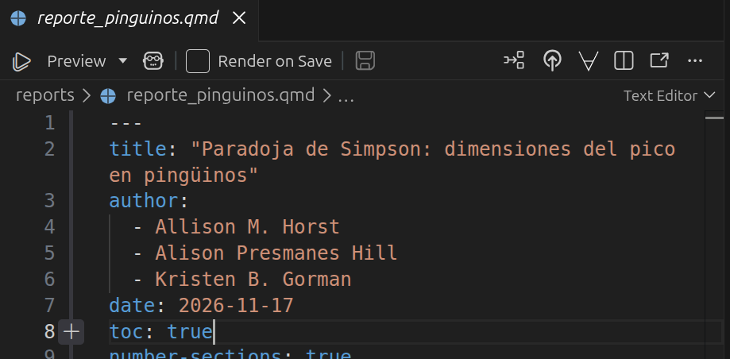

# Bienvenidos a Quarto {#sec-welcome-to-quarto}

```{r}
#| echo: false
source("_common.R")
```

```{r}
#| label: load-r-packages
#| echo: false
#| message: false
```

Este capítulo se basa en [@posit_introduction_2026], [@wickham_r_2023, Cap. 28] y [@m_horst_palmer_2022] así como en la documentación oficial de [`quarto`]() donde tiene como propósito introducir la forma de comunicar resultados a través del uso de [**Quarto**]() e información de la base de datos `penguins` disponible en [@kaye_preparing_2025] así como en el paquete `datasets` de base R.

Exploraremos los siguientes aspectos:

1. ¿Qué es Quarto?
2. ¿Cuál es la anatomía de un documento en extensión `.qmd`?

:::: {#nte-1-chap-21 .callout-note}
Para desarrollar el contenido de este capítulo es necesario que descargues el archivo en extensión `.qmd` señalado a continuación:

::: {.callout appearance="minimal"}
## {fig-alt="Ícono del explorador de archivos" height=25} [reporte_pinguinos.qmd](){download="reporte_pinguinos.qmd"}
:::

Luego, genera una carpeta con el nombre `reports` y dentro de esta carpeta incluye el archivo `reporte_pinguinos.qmd`.

Además, es necesario que descargues los archivos en extensión `.png` señalados a continuación: 

::: {.callout appearance="minimal"}
## {fig-alt="Ícono del explorador de archivos" height=25} [culmen_depth_es.png](){download="culmen_depth_es.png"}
:::

::: {.callout appearance="minimal"}
## {fig-alt="Ícono del explorador de archivos" height=25} [penguins.png](){download="penguins.png"}
:::

Luego, genera una carpeta con el nombre `images` y dentro de esta carpeta incluye los archivos `culmen_depth_es.png` y `penguins.png`.

Adicionalmente, es necesario que descargues los archivos en extensión `.bib` y `.csl` señalados a continuación:

::: {.callout appearance="minimal"}
## {fig-alt="Ícono del explorador de archivos" height=25} [reporte-pinguinos.bib](){download="reporte-pinguinos.bib"}
:::

::: {.callout appearance="minimal"}
## {fig-alt="Ícono del explorador de archivos" height=25} [apa.csl](){download="apa.csl"}
:::

Luego, genera una carpeta con el nombre `references` y dentro de esta carpeta incluye los archivos `reporte-pinguinos.bib` y `apa.csl`.

En caso que hayas seguido estas indicaciones, procede a crear una nueva carpeta llamada `021_intro-quarto-r` y dentro de ella genera el archivo `001_intro-quarto.qmd`, siguiendo las pautas de la @sec-package-usage pero con un archivo en extensión `.qmd`.

::::

## ¿Qué es Quarto?

[**Quarto**]() es un sistema de publicación científica y técnica de código abierto que proporciona un marco unificado para el análisis de datos. Su propósito es combinar en un único archivo de texto plano 3 componentes [@posit_introduction_2026]:

1. **Texto narrativo:** Redactado mediante [**Markdown**]().
2. **Código ejecutable:** Escrito en lenguajes de programación como R, Python, Julia u Observable.
3. **Resultados dinámicos:** Gráficos, tablas y estimaciones generados directamente al ejecutar el código.

Esta integración se basa en la idea de [**literate programming**]() (en español **programación literaria**). En lugar de mantener un archivo, como por ejemplo en extensión `.R`, con comentarios dispersos o copiar y pegar resultados manualmente entre herramientas, el código y la narrativa se integran para que el documento se lea de principio a fin. De esa manera, se logra que los resultados se actualicen automáticamente y permanezcan siempre en sincronía con los datos [@posit_introduction_2026; @wickham_r_2023, Cap. 28].

### Problemas que resuelve

En algunos flujos de trabajo, el análisis suele terminar copiando y pegando manualmente gráficos y valores desde el entorno de programación hacia un procesador de texto o diapositivas [@posit_introduction_2026]. Este proceso manual es propenso a errores y resulta ineficiente ya que si los datos cambian, es necesario repetir todo el procedimiento [@wickham_r_2023, Cap. 28].

Quarto soluciona esta dificultad al mantener el texto, el código y los resultados integrados en un único archivo así como aportando 3 beneficios [@posit_introduction_2026]:

1. **Reproducibilidad:** los resultados provienen directamente de ejecutar el código. En ese sentido, otro individuo puede reconstruir el documento y obtener los mismos resultados.
2. **Actualización permanente:** si se incorporan nuevos datos o se ajusta el código, solo se requiere volver a compilar el documento para que cada tabla, gráfico y valor se actualice.
3. **Archivos de texto plano:** los documentos `.qmd` son texto plano, lo que facilita editarlos y realizar seguimiento a los cambios mediante sistemas de control de versiones como [**Git**]().

### Renderizar un documento

El proceso de transformar un archivo que combina texto y código en un producto final se conoce como **renderizar** (en inglés **render**) [@posit_introduction_2026]. Al renderizar, el archivo original en extensión `.qmd` permanece intacto, generando un nuevo archivo de salida con los resultados incorporados. En la @fig-render-qmd-flow se describe la secuencia de pasos que Quarto realiza durante este proceso [@quarto_core_team_tutorial_2026]:

{#fig-render-qmd-flow fig-alt="Diagrama de flujo de Quarto: archivo .qmd pasando por knitr hacia .md, luego procesado por pandoc hacia formatos PDF, MS Word o HTML" fig-align="center"}

1. `.qmd`: es el archivo fuente en texto plano que contiene la combinación de texto narrativo en Markdown y los bloques de código.
2. `knitr`: es el "motor" encargado de ejecutar secuencialmente cada una de las celdas de código presentes en el documento.
3. `.md`: a partir de la ejecución, se genera un archivo intermedio en formato Markdown que integra el texto original junto con las salidas generadas por el código, como por ejemplo tablas, figuras y valores numéricos.
4. `pandoc`: es el conversor de documentos que toma el archivo `.md` intermedio y lo traduce al formato final especificado, como por ejemplo páginas web HTML, documentos PDF o archivos de Microsoft Word y OpenDocument.

Para renderizar un documento de Quarto de acuerdo a lo descrito en la @fig-render-qmd-flow selecciona el ícono de archivos {fig-alt="Ícono del explorador de archivos" height=25} en la **Barra de actividades** y abre el archivo `reporte_pinguinos.qmd` utilizando la **Barra lateral primaria** (ver @fig-positron-layout-outline) en la carpeta `reports`. En el **Editor** puedes renderizar el documento utilizado la opción **Preview**, tal como se señala en la @fig-render-qmd-preview. 

{#fig-render-qmd-preview fig-alt="Captura de pantalla del Editor en Positron resaltando la opción Preview en la barra de herramientas superior para renderizar el archivo reporte_pinguinos.qmd" fig-align="center"}

También puedes situar el cursor (**|**) sobre alguna parte del documento y presionar la combinación de teclas  o utilizar el **Terminal** en el **Panel** ejecutando el siguiente comando, tal como se señala a continuación:

```bash
quarto render reports/reporte_pinguinos.qmd
```

De esa manera, en la **Barra lateral primaria** encontrarás que se crea un archivo adicional dentro de la carpeta `reports` con el nombre `reporte_pinguinos.html`. En ese sentido, se crea un archivo con extensión `.html` manteniendo intacto el archivo de texto plano `reporte_pinguinos.qmd` donde se completa el proceso señalado en la @fig-render-qmd-preview. 

### Formatos de salida para documentos


## Anatomía de un documento de Quarto


### Encabezado YAML


### Texto Markdown


### Celdas de código